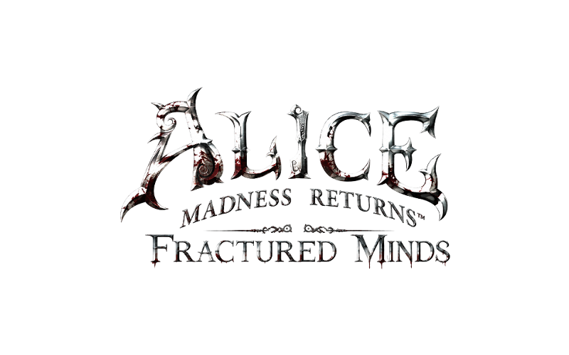

# Alice Madness Returns Fractured Minds

  

Descriptions in other languages:
Español: [README_SP](https://github.com/wndsun/Alice-Madness-Retruns-Fractured-Minds/blob/main/README_SP.md)
日本語: [README_JP](https://github.com/wndsun/Alice-Madness-Retruns-Fractured-Minds/blob/main/README_JP.md)
Русский: [README_RU](https://github.com/wndsun/Alice-Madness-Retruns-Fractured-Minds/blob/main/README_RU.md)
Italiano: [README_IT](https://github.com/wndsun/Alice-Madness-Retruns-Fractured-Minds/blob/main/README_IT.md)
Français: [README_FR](https://github.com/wndsun/Alice-Madness-Retruns-Fractured-Minds/blob/main/README_FR.md)
Deutsch: [README_GE](https://github.com/wndsun/Alice-Madness-Retruns-Fractured-Minds/blob/main/README_GE.md)

Two-player co-op for the PC version of *Alice: Madness Returns*.
Based on / fork of [Alice Co-op](https://github.com/docwitson/Alice-Madness-Returns-Co-op) by Docwitson, built on [MadnessPatch](https://github.com/Wemino/MadnessPatch).

### Download
**`AliceFracturedMinds-1.0.0.zip`** - extract it into `<game>\Binaries\Win32` (the folder with `AliceMadnessReturns.exe`). Both players need this same release.

### Quick start
1. Start the game normally (Steam / EA App) and press **M**.
2. Host: choose *Host* → *Save* (starts the relay server).
   Client: choose *Client*, enter the host's LAN/VPN address → *Save*.
3. Restart the game after changing the role. The host enters gameplay, the client presses **L** to join.

## Full guide:

English: [docs/INSTALL.md](https://github.com/wndsun/Alice-Madness-Retruns-Fractured-Minds/blob/main/docs/INSTALL.md)

Русский: [docs/INSTALL_RU.md](https://github.com/wndsun/Alice-Madness-Retruns-Fractured-Minds/blob/main/docs/INSTALL_RU.md)

日本語: [docs/INSTALL_JP.md](https://github.com/wndsun/Alice-Madness-Retruns-Fractured-Minds/blob/main/docs/INSTALL_JP.md)

Español: [docs/INSTALL_SP.md](https://github.com/wndsun/Alice-Madness-Retruns-Fractured-Minds/blob/main/docs/INSTALL_SP.md)

Italiano: [docs/INSTALL_IT.md](https://github.com/wndsun/Alice-Madness-Retruns-Fractured-Minds/blob/main/docs/INSTALL_IT.md)

Français: [docs/INSTALL_FR.md](https://github.com/wndsun/Alice-Madness-Retruns-Fractured-Minds/blob/main/docs/INSTALL_FR.md)

Deutsch: [docs/INSTALL_GE.md](https://github.com/wndsun/Alice-Madness-Retruns-Fractured-Minds/blob/main/docs/INSTALL_GE.md)

### What's new compared to Alice Co-op 0.1.0-alpha.1
- In-game co-op menu (**M**): role, server address and port; the host can start the server from the menu. No external launcher needed.
- Watching the host in the London chapters.
- Synchronized Executioner chase: hits, knockback, laugh and end of the chase.
- Shared enemy spawns after death, restart and Continue.
- Many crash fixes (respawn, map changes, enemy teardown).
- Fixed cloned enemies after Continue, cutscene-skip desync, Elite Card Guard encounters and checkpoint mismatch when continuing from the main menu.
- New `AliceCoop.ini` options: `GameConsole`, `Logs`, `Dumps`.

Full list: [CHANGELOG.md](https://github.com/wndsun/Alice-Madness-Retruns-Fractured-Minds/blob/main/CHANGELOG.md)

### Requirements
- A legitimate PC copy of the game for each player (Steam or EA App). No game files are included.
- Windows 10/11, Microsoft Visual C++ 2015-2022 Redistributable **x86**.
- The same PC, a LAN, or a trusted VPN (e.g. Radmin VPN).

> [!WARNING]
> The relay server has no authentication or encryption. Never forward its port (UDP 27018) to the Internet.
> The archive replaces `dinput8.dll` and `MadnessPatch.ini` - back them up and back up your saves.

### Reporting bugs
Logs are off by default. Set `Logs = 1` in `[Debug]` of `AliceCoop\AliceCoop.ini`, reproduce the problem and attach the files from `AliceCoop\logs` to an [issue](https://github.com/wndsun/Alice-Madness-Retruns-Fractured-Minds/issues).